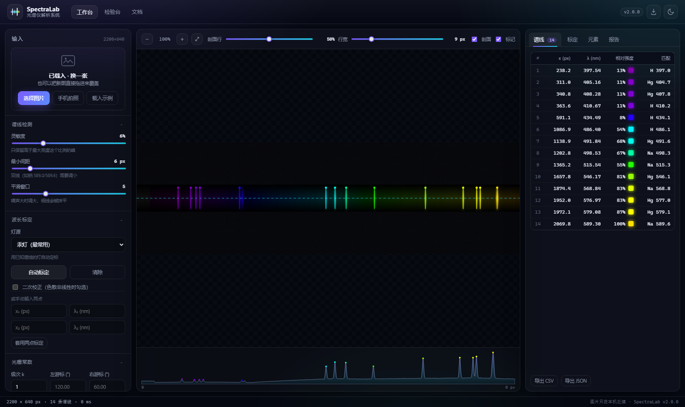

# SpectraLab · 光谱仪解析系统

<p align="center">
  
</p>

<p align="center">
  <b>一张光谱照片 → 一张可核对的谱线表。</b><br>
  自动找谱线、标定波长、识别元素、算光栅常数与不确定度。<br>
  <b>全部在浏览器本地完成，图片不上传。</b>
</p>

<p align="center">
  <a href="https://github.com/LLYlab/LLY_Light_Chem/actions/workflows/ci.yml"></a>
  
  
  
  
</p>

<p align="center">
  <a href="https://llylab.github.io/LLY_Light_Chem/"><b>▶ 在线使用</b></a> ·
  <a href="https://llylab.github.io/LLY_Light_Chem/lab.html">连续检验台</a>
</p>



---

## 为什么做这个

大学物理实验里测光谱，流程通常是：调分光计 → 对游标 → 读衍射角 → 查表 → 算光栅常数 → 写报告。
但**一张光谱照片里本来就有全部信息**：每条谱线的位置、颜色、间距。

SpectraLab 把中间那段手工活自动化：

- 你只需要一张**拍得不算太差**的光谱照片；
- 它负责找线、定标、认元素、算 d；
- 所有结果都带**可复核的数字**（R²、RMS、每条线的残差），而不是一句"识别成功"。

## 三种发行形态

| 形态 | 入口 | 适合谁 |
|---|---|---|
| **网页版** | [`web/index.html`](web/index.html) | 电脑浏览器，功能最完整 |
| **移动版** | 同一页面，浏览器菜单里「添加到主屏幕」 | 手机拍完当场出结果，离线也能开 |
| **连续检验版** | [`web/lab.html`](web/lab.html) | 想知道"这套算法到底准不准"的人 |

网页版和移动版是**同一份代码**：响应式布局 + PWA 清单 + Service Worker，装到桌面/主屏幕后和原生应用一样全屏运行。

## 30 秒上手

1. **给光谱拍张照**（或直接拖一张图进来）
2. 看右边「谱线」表：每条线的位置、波长、颜色
3. 点「自动标定」，选汞灯（最常用）
4. 去「报告」页生成 PNG，或导出 CSV

> 没带照片？点「载入示例」，它会现场合成一张已知答案的光谱给你试。

### 怎么拍一张能用的照片

- **横平竖直**：谱线要平行于画面上下边
- **别过曝**：亮线周围不要糊成白色，暗背景里能分清几条线最好
- **带上参照**：同一张图里拍到刻度、或已知双线（钠双线最佳）
- **拍平**：手机尽量与目镜/屏幕平行，避免透视变形

## 装到手机上（移动版）

同一个网址，装到主屏幕后就是全屏应用，没有地址栏：

- **iPhone / iPad**：Safari 打开 → 分享按钮 → 「添加到主屏幕」
- **Android**：Chrome / Edge 打开 → 右上角 ⋮ → 「安装应用」或「添加到主屏幕」
- 装好后可以**离线打开**（Service Worker 缓存），拍照按钮直接调起相机

> 手机端的隐藏技巧：把手机固定在目镜前拍，比手持稳得多；拍完直接用同一台手机分析，不用传电脑。

## 功能

| 模块 | 说明 |
|---|---|
| **找峰** | 亮度剖面 → 平滑 → 局部极大 → 显著度过滤 → 抛物线亚像素 |
| **标定** | Hg / Na / H / He 自动匹配；也可手动输入两点；支持二次校正 |
| **元素识别** | 12 种元素谱线库；命中 ≥3 条才给结论，按命中数与残差排序 |
| **光栅常数** | `d = kλ / sinθ`，左右游标自动求 θ，附不确定度传播 |
| **可视化** | 峰值标记按波长上色；剖面曲线与图片共用 x 轴 |
| **导出** | CSV / JSON / 报告 PNG / 打印为 PDF |
| **隐私** | 纯前端，无后端、无上传、无遥测 |

## 精度与边界

**合成数据**（[`web/lab.html`](web/lab.html) 连续检验，8 项全绿）：

- 找峰召回 100%，位置误差 ~0.01 px
- 汞灯标定后波长最大误差 **< 0.01 nm**
- 噪声从 1 加到 8，峰数波动 0

**真实照片**会差一些，主要受限于：像素分辨率、离焦、曝光、以及"线性色散"这个近似。

诚实的边界：

- 色散近似为 `λ = a·x + b`；光谱仪本身有轻微非线性时，勾选「二次校正」
- 元素库只有 12 种（Hg/Na/H/He/Ne/Ar/Kr/Ca/Cd/Zn/Cu/Li），库外元素会**认不出**，而不是乱认
- 双线（如钠 589.0/589.6）能否分开取决于照片分辨率：本工具不会替你"脑补"分开
- 结果用于实验报告时，请自己核对一遍量级与单位

## 连续检验台

[`web/lab.html`](web/lab.html) 用**已知答案的合成光谱**反向考核算法：

1. 随机造一张光谱（已知色散、已知谱线、已知噪声）
2. 跑同一套找峰 / 标定 / 识别
3. 和真值对比，报告误差

每次点「跑一次」都换随机参数，所以它回答的是**稳不稳**，而不是**演示好不好看**。
「连续 30 轮」会累积通过率与最差误差，可导出 JSON。

## 本地运行

```bash
# 方式一：任意静态服务器
node tools/serve.mjs          # http://127.0.0.1:8099/
python -m http.server 8099 -d web

# 方式二：直接双击 web/index.html
# （PWA 安装与 Service Worker 需要 http/https，file:// 下不注册，其余功能正常）
```

## 测试

```bash
npm test                      # 17 项单元测试（Node 内置 test runner）
node tools/check_web.mjs      # 检查 HTML/CSS/JS/图标/manifest/SW 资源是否齐全
```

CI 在每次 push 时跑这两条（见 [.github/workflows/ci.yml](.github/workflows/ci.yml)）。

## 目录结构

```
web/
  index.html          工作台
  lab.html            连续检验台
  styles.css          设计系统
  js/core.js          算法层（纯函数，可被 Node 测试）
  js/app.js           交互与渲染
  js/lab.js           检验台用例
  sw.js / manifest    PWA
desktop/
  spectrum_app.py     旧版 Tkinter 桌面程序（保留，功能等同于网页版的子集）
tests/
  core.test.mjs       单元测试
tools/
  serve.mjs           本地预览服务器
  check_web.mjs       资源完整性检查
  make_icons.py       图标生成
docs/
  shots/              截图
```

## 常见问题

**Q：图片会上传到服务器吗？**
不会。整份代码没有后端，图片只存在于浏览器的 canvas 里。断网也能用。

**Q：为什么我的图识别不出来？**
先调左侧「灵敏度 / 最小间距 / 平滑窗口」，再看「标定」里的 R²。R² < 0.999 时多半是照片有问题（倾斜、过曝、只有一两条线）。

**Q：能识别未知元素吗？**
只能从 12 种库里"认"，不能凭空发现新元素。库外元素会显示为"—"，这是有意的。

**Q：为什么波长跟标准值差 0.3 nm？**
可能来自：像素分辨率不足、线性色散近似、或者标定用的灯线本身不够多。用二次校正、或加拍一张多点标定的图可以改善。

## 许可

[MIT](LICENSE) © 2026 LLYlab

---

## English

**SpectraLab** turns a photograph of a spectrometer output into a verifiable line list:
auto peak detection, wavelength calibration (Hg/Na/H/He), element identification, grating
constant `d = kλ/sinθ` with uncertainty, and a printable report — **entirely in the browser**,
no backend, no upload, works offline.

- Web app: [`web/index.html`](web/index.html) · Test bench: [`web/lab.html`](web/lab.html)
- PWA: installable on desktop and mobile
- Tests: `npm test` (17 unit tests) + continuous bench (8 suites)

Known limits: linear dispersion approximation (quadratic correction available), a 12-element
reference library, and accuracy bounded by the source photo resolution.
